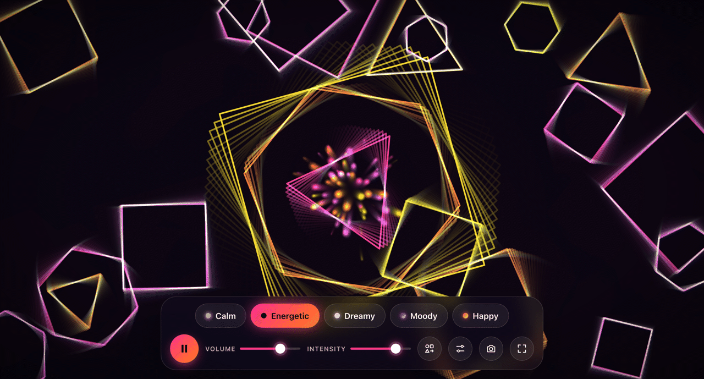

# moodwave

**Pick a mood. Hear it. See it.** A music visualizer that generates original music and matching audio-reactive visuals, live in your browser.

🔗 **Live demo:** [moodwave.carterscoding.com](https://moodwave.carterscoding.com)



---

## About

moodwave turns a feeling into a small live show. Choose a mood (Calm, Energetic, Dreamy, Moody or Happy) and the page composes looping, slowly evolving music with the Web Audio API while a full-screen canvas animation pulses, bursts and swirls in time with it.

- 🎹 **100% generated audio.** Oscillators, filters, envelopes and synthesized drums. No audio files.
- 🌈 **Five moods**, each with its own tempo, key, instruments and colors.
- 🔷 **12 animated shape styles** (circles, ripples, waves, polygons, warp-speed stars, synthwave grid, radial spectrum, glows, bubbles, swirls, a spiral galaxy and confetti). Each mood cycles through its own set about every 20 seconds, switching on a beat.
- 📈 **Truly audio-reactive.** Visuals are driven by real frequency analysis (bass, mids, treble, beat detection), not a timer.
- 🔀 **Smooth crossfades** between moods, for both sound and visuals.
- 🎛️ **Controls:** play/pause, volume, visual intensity, next shape set, fullscreen and PNG screenshots. They fade away when you stop moving the mouse.
- 📱 **Works on desktop and mobile.** Tap the canvas for particle bursts.
- 📦 **Zero dependencies.** Plain HTML, CSS and JavaScript (ES modules). No build step.

### Keyboard shortcuts

| Key | Action |
| --- | --- |
| `Space` | Play / pause |
| `1`–`5` | Switch mood |
| `N` | Next shape set |
| `F` | Toggle fullscreen |
| `S` | Save screenshot |

## Run it locally

ES modules don't load from `file://`, so serve the folder with any static server:

```bash
# Node
npx serve .

# or Python 3
python3 -m http.server 8000
```

Then open the printed URL (e.g. `http://localhost:8000`) and press **Start**.

## Deploy with GitHub Pages

1. Push this repo to GitHub.
2. Go to **Settings → Pages**.
3. Under **Build and deployment**, choose **Deploy from a branch**, select the **`main`** branch and the **`/ (root)`** folder, then **Save**.
4. After a minute the site is live at `https://<username>.github.io/moodwave/`.

All paths are relative, so the site works from that subpath as-is.

**Custom domain:** the `CNAME` file points Pages at `moodwave.carterscoding.com`. Add a `CNAME` DNS record for `moodwave` → `<username>.github.io`, then enable **Enforce HTTPS** in Settings → Pages. If you don't use a custom domain, delete `CNAME`.

## Project structure

| File | What it does |
| --- | --- |
| `index.html` | Page structure: canvas, welcome screen and control bar. |
| `style.css` | All styling: CSS variables, glass UI, animations, idle fade and responsive layout. |
| `audio.js` | The `MOODS` config plus the Web Audio engine: synth voices, drums, step sequencer, crossfades and the `AnalyserNode`. |
| `visuals.js` | Canvas animation loop, 12 shape renderers, shape-set cycling, particle bursts, crossfades and snapshots. |
| `main.js` | App setup: builds mood buttons, wires controls, keyboard shortcuts and idle detection, and connects audio to visuals. |
| `favicon.svg`, `apple-touch-icon.png` | Site icon (browser tab and iOS home screen). |
| `CNAME` | Custom domain for GitHub Pages. |
| `LICENSE` | MIT license. |

## How the audio and visuals connect

```
 audio.js                                              visuals.js
┌───────────────────────────────────────────┐        ┌──────────────────────────┐
│ sequencer → synths/drums → mood bus ┐     │        │ requestAnimationFrame    │
│                (crossfade per mood) │     │        │   ↓                      │
│                                     ↓     │        │ getLevels() ─────────────┼─┐
│ reverb ←──────────────────────── master   │        │   ↓                      │ │
│                                     ↓     │        │ renderer(shape) draws    │ │
│                         compressor → AnalyserNode ─┼─→ bass/mid/treble/hit    │ │
│                                     ↓     │        └──────────────────────────┘ │
│                                 speakers  │                                     │
└───────────────────────────────────────────┘  main.js passes engine.getLevels ──┘
```

1. **Scheduling.** A lookahead scheduler queues 16th-note steps about 120 ms ahead on the `AudioContext` clock, so timing stays tight even if the page is busy.
2. **Analysis.** Everything passes through an `AnalyserNode`. `getLevels()` reads its frequency data once per frame and returns `{ volume, bass, mid, treble, bassHit, spectrum }`. The levels are 0–1, `bassHit` is a simple onset detector that fires when bass energy jumps above its running average, and `spectrum` is the raw frequency data (used by the radial spectrum shape).
3. **Reaction.** Each renderer maps those values to motion. When a shape set has run its time, the next one crossfades in on the following bass hit. Inside each renderer: bass grows and pushes shapes, `bassHit` triggers bursts and jumps, mids drive opacity, and treble brightens colors and speeds up spin. The **intensity** slider scales all of it.
4. **Variation.** Every 4 bars the melody motif mutates a couple of notes, chords are occasionally substituted or revoiced, and ghost notes are randomized, so loops stay recognizable without repeating exactly.

## Add a new mood

Everything about a mood lives in the `MOODS` object at the top of [`audio.js`](audio.js). Add an entry and the button, music and visuals all appear automatically:

```js
export const MOODS = {
  // ...existing moods
  spooky: {
    label: 'Spooky',
    music: {
      bpm: 90, root: 45, scale: MINOR, progression: [0, 1, 0, 4], seventh: true,
      swing: 0, reverb: 0.7, fills: false,
      pad:  { type: 'sawtooth', octave: 0, gain: 0.07, pattern: 'x', dur: 16, attack: 1, release: 2, cutoff: 900, detune: 20, voices: 2 },
      bass: { type: 'sine', octave: -1, gain: 0.25, pattern: '1.......1...5...', dur: 4, cutoff: 400 },
      lead: { type: 'triangle', octave: 1, gain: 0.05, every: 4, density: 0.3, dur: 2, attack: 0.02, release: 0.8, cutoff: 2000 },
      arp: null,
      drums: { kick: 'x.......x.......', snare: '............x...', hat: '', gain: 0.6 },
    },
    visual: { shapes: ['galaxy', 'warp', 'ripples'], cycle: 15, palette: ['#39ff14', '#8a2be2', '#ff6f00'], background: '#030806', trail: 0.1, speed: 0.6 },
  },
};
```

- **Music fields** are documented in the comment above `MOODS`. Patterns are 16-step strings (`x` hit, `-` ghost, `.` rest; bass uses `1 3 5 8` for chord tones).
- **`visual.shapes`** lists the renderers to cycle through, in order: `circles`, `ripples`, `waves`, `geometric`, `warp`, `grid`, `spectrum`, `glow`, `bubbles`, `swirl`, `galaxy`, `confetti`. The optional `cycle` sets the seconds per set (default 20). For a brand-new look, add an `{ init, draw }` entry to `SHAPES` in [`visuals.js`](visuals.js).
- Keys `1`–`9` map to moods in the order they're defined.

## Ideas for future features

- 🎤 Microphone / file input mode to visualize your own music
- 🎚️ Per-mood tweakable tempo and key
- 🔴 Record a clip to WebM with `MediaRecorder`
- 🔗 Shareable URLs (`?mood=dreamy&intensity=80`)
- 🌗 Blend two moods at once with a slider
- 🧠 Seeded randomness so a favorite variation can be replayed
- 📲 Installable PWA with offline support

## License

[MIT](LICENSE) © 2026 Carter K
